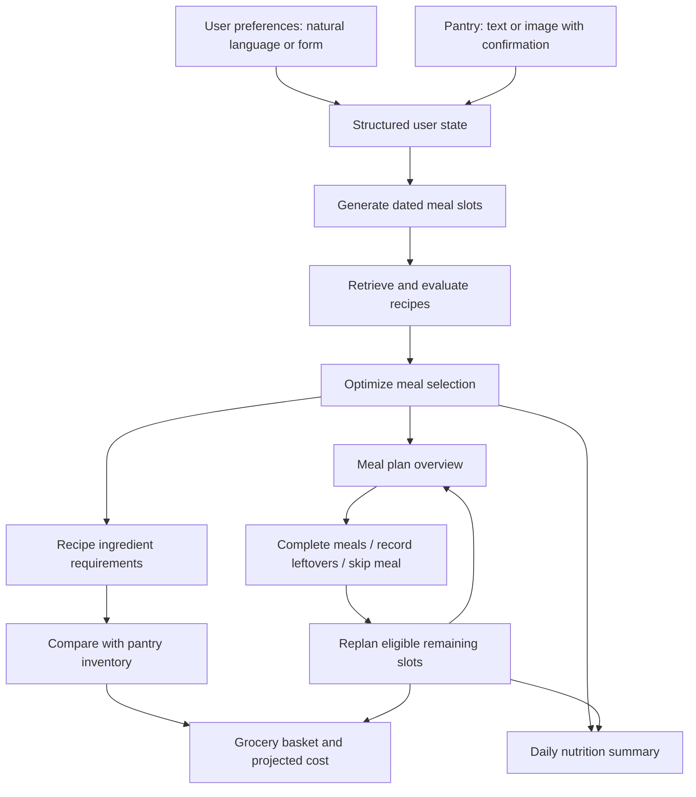

# Intelligent Adaptive Meal Planner (IAMP)

Our model is meal-planning application that creates personalized multi-day meal plans, considers available pantry ingredients, estimates grocery needs, presents nutrition summaries, and adapts future meals when plans change.

## Features

- **Flexible preference entry:** Describe a meal plan in natural language or enter preferences manually, including duration, meal types, budget, dietary restrictions, allergies, cuisines, cooking time, and cooking frequency.
- **Multi-day planning:** Generate meal slots, evaluate candidate recipes against planning constraints, and prefer variety where feasible.
- **Recipe ingredient details:** View ingredients and quantities associated with selected recipes.
- **Pantry input:** Enter ingredients as text or use the pantry-image workflow, then review and confirm the recognized items and quantities.
- **Grocery planning:** Aggregate ingredient requirements, subtract usable pantry quantities, and estimate purchases using available retail package and price information.
- **Quantity transparency:** Distinguish exact, estimated, and unresolved ingredient or package conversions rather than assuming unsupported equivalences.
- **Nutrition summary:** View calculated daily nutrition totals for planned meals.
- **Adaptive replanning:** Mark meals completed, record prepared leftovers, skip an upcoming meal, and recalculate eligible remaining meals. Valid approved leftovers may be reused without purchasing their raw ingredients again.
- **Saved workspaces:** Retain preferences, pantry information, and planning results in a workspace.

## How it works



The planner respects configured constraints; if it cannot fill every requested slot, the result may be partial. Grocery estimates can remain uncertain when package coverage or ingredient conversions cannot be verified.

## Project structure

| Directory | Purpose |
| --- | --- |
| `app/` | Streamlit entry point, pages, and UI state handling |
| `src/agents/` | Recipe, ingredient, and grocery agent logic |
| `src/planning/` | Meal-slot generation, optimization, cooking schedule, and validation |
| `src/state/` | Inventory and planning-related state operations |
| `src/` | Supporting parsing, normalization, retrieval, and reasoning components |
| `scripts/` | Data preparation, verification, and end-to-end utilities |
| `tests/` | Automated unit and integration tests |
| `data/` | Recipe/ingredient knowledge bases and local runtime data (availability depends on setup) |

## Requirements and setup

- Python 3.12 is the version used for the reported development tests.
- Install the project's Python dependencies, including Streamlit and the libraries used by the planning and retrieval components.
- Ensure the required recipe and ingredient knowledge-base datasets are present.
- For image-based pantry recognition, configure the credentials required by the image-recognition integration.

> **Repository setup note:** The supplied snapshot's `requirements.txt` lists `google-genai` but does **not** provide a complete dependency lockfile. Installing that file alone may not install all libraries needed to run the app. Likewise, `.gitignore` excludes `data/processed/`, so teammates may need the prepared knowledge-base files separately. Do not commit `.env` or API keys.

From the repository root:

```bash
python3.12 -m venv .venv
source .venv/bin/activate  # Windows: .venv\Scripts\activate
python -m pip install --upgrade pip
python -m pip install -r requirements.txt
```

Before starting the app, make sure all additional project dependencies and required local datasets have been installed/provisioned. Check with the project team for the agreed environment configuration and data preparation steps.

## Run the application

From the repository root:

```bash
PYTHONPATH=. python -m streamlit run app/streamlit_app.py
```

Open the local URL printed by Streamlit in your browser.

## Using the application

### 1. Create a meal plan

1. Open **Create a meal plan**.
2. Enter a natural-language request or fill out the preference fields manually.
3. Confirm the duration, meals per day, budget, dietary preferences, cooking time, and cooking frequency.
4. Add or confirm pantry ingredients as needed.
5. Generate the plan and open **Overview** to see meals grouped by date.

### 2. Review groceries and nutrition

- In **Overview**, inspect the selected recipes and their ingredient requirements.
- In **My pantry**, review available ingredients.
- In **Shopping list**, inspect purchase requirements and projected costs after pantry subtraction.
- In **Nutrition**, inspect calculated nutrient totals for the selected meals. Totals reflect planned meals, not necessarily an entire day's food intake.

### 3. Adapt an existing plan

1. Open **Adjust my plan**.
2. Select meals already eaten and click **Save completed meals**. Verify they appear in **Meals already eaten**.
3. Optionally record a prepared leftover with its recipe, remaining servings, preparation date, use-by date, and storage method.
4. Select an upcoming meal to skip.
5. Optionally approve eligible prepared leftovers.
6. Click **Skip meal and update plan** and wait for the background job to finish.
7. Check that completed meals remain in history, the skipped slot is absent from **Current meals**, and eligible leftovers have been allocated only when valid.

A skipped slot is removed; an approved leftover may be assigned to **another** eligible unfinished slot. Approval alone does not guarantee consumption.

## Testing

Run all tests from the repository root:

```bash
PYTHONPATH=. python -m pytest -q
```

Run the focused adaptive replanning suites:

```bash
PYTHONPATH=. python -m pytest \
  tests/test_completed_meals_replanning.py \
  tests/test_replanning_workflow.py \
  tests/test_adaptive_replanning_integration.py -v
```

An end-to-end verification script is also available:

```bash
PYTHONPATH=. python scripts/run_day5_e2e.py
```

The last user-reported checks on the working branch were **981 passing tests**, **47 passing subtests**, and **51 passing focused adaptive replanning tests**. These are historical results, not a guarantee for every checkout or machine.

## Troubleshooting

**No meals generated:** Verify the active Git branch and revision, required datasets, dependency installation, user constraints, and terminal/background-job logs. A plan can be partial if constraints prevent selection.

**Works on one computer but not another:** Check for missing ignored data files (`data/processed/`), local configuration, credentials, or machine-specific paths. Do not assume `git pull` transfers ignored datasets.

**Completed meals still appear in Current meals:** Ensure you clicked **Save completed meals** before replanning and that **Meals already eaten** shows the expected count.

**A skipped meal still appears:** Wait for the replan job to complete and verify that the updated workspace was loaded.

**A leftover was not reused:** Check that it was approved, has remaining servings, has valid preparation/use-by dates and storage details, and that an eligible unfinished slot exists.

**Grocery estimate is uncertain:** Some ingredient quantities or retail package units cannot be converted with verified factors. Such items are kept provisional rather than treated as confirmed coverage.

## Project status

Our supports multi-day meal planning, pantry-aware grocery calculations, nutrition summaries, and adaptive replanning. The application is a project implementation; output quality depends on recipe data, product coverage, configuration, and the constraints provided. Always review quantities, food storage dates, and nutrition estimates before relying on them.
